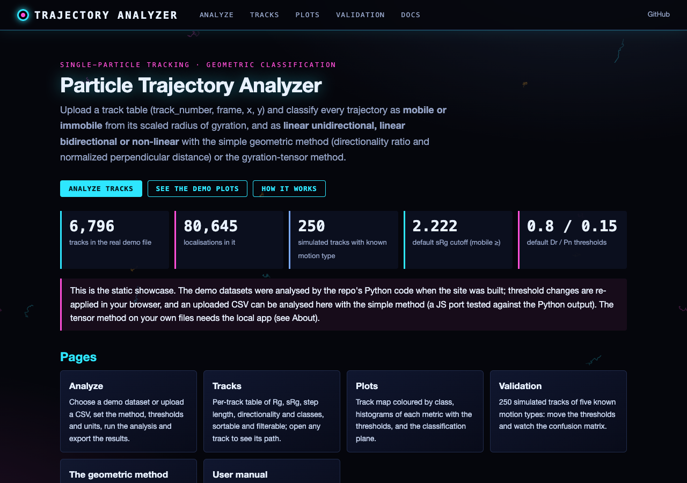
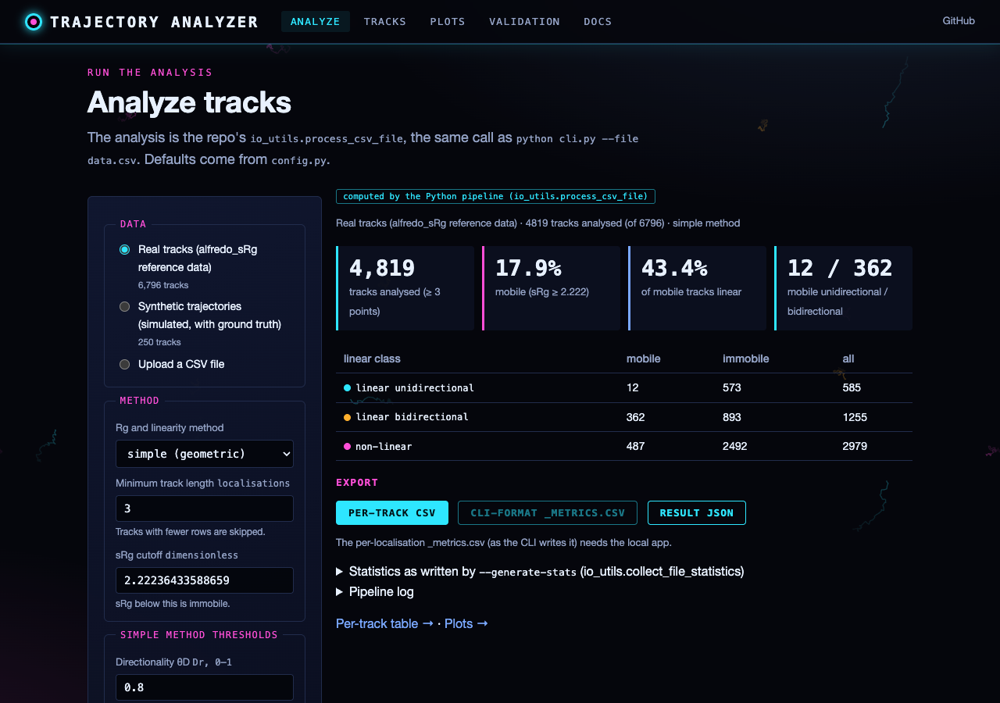
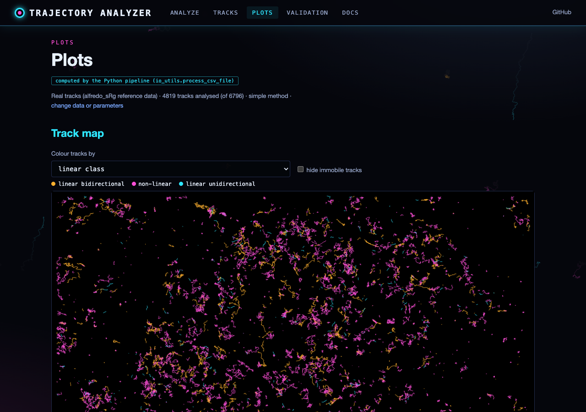
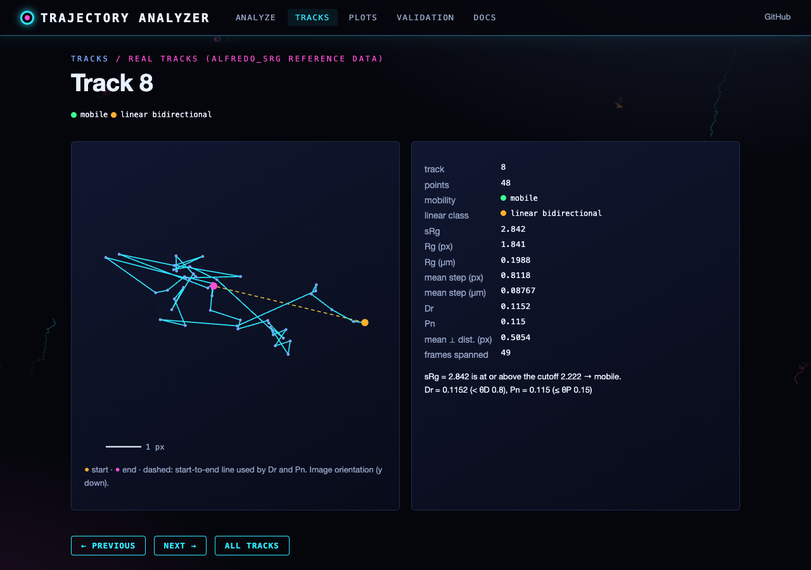
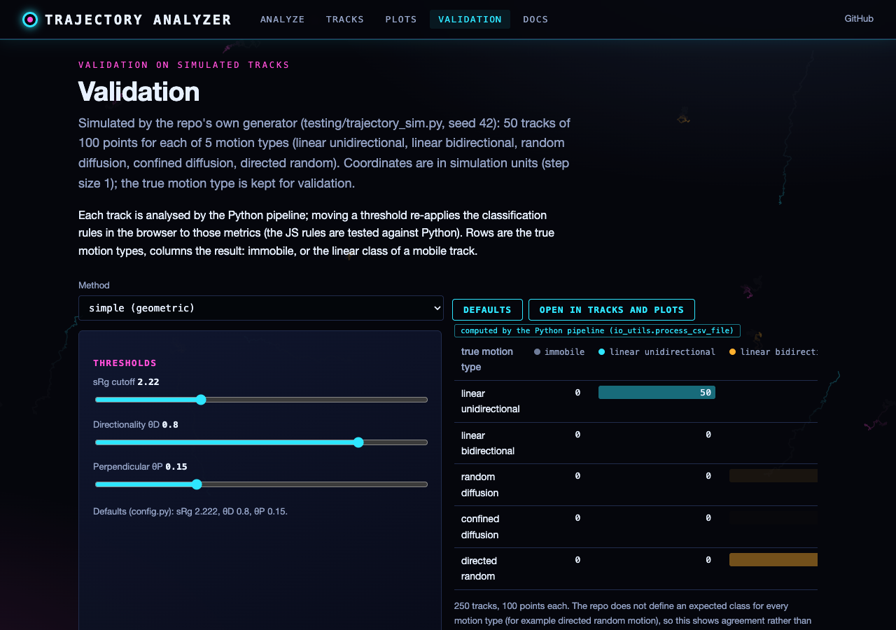

# Geometric Method for Linear Motion Classification in Single-Particle Trajectories


A computationally efficient geometric method for classifying linear motion in single-particle tracking data without requiring tensor decomposition. The method employs two primary metrics: directionality ratio and normalized perpendicular distance, to classify trajectories as linear unidirectional, linear bidirectional, or non-linear. This approach provides comparable classification accuracy to eigenvalue-based methods while offering computational advantages for large-scale trajectory analysis.

## 1. Introduction

A critical challenge in SPT analysis is the automated classification of trajectory patterns, particularly distinguishing between linear (directed or confined linear) and non-linear (random or confined) motion modes

Traditional approaches rely on gyration tensor decomposition to extract eigenvalues and eigenvectors that characterize trajectory shape. While mathematically rigorous, these methods are computationally intensive for large datasets. Here, we introduce a simple geometric method that achieves robust linear motion classification using direct geometric measurements.

## 2. Mathematical Framework

### 2.1 Trajectory Representation

Consider a trajectory consisting of *N* positions recorded at discrete time points:

**X** = {**x**<sub>i</sub> = (*x*<sub>i</sub>, *y*<sub>i</sub>) | *i* = 1, 2, ..., *N*}

where **x**<sub>i</sub> represents the particle position at frame *i*.

### 2.2 Radius of Gyration (Simple Method)

The radius of gyration *R*<sub>g</sub> quantifies the spatial extent of a trajectory:

*R*<sub>g</sub> = √[⟨**x**<sup>2</sup>⟩ - ⟨**x**⟩<sup>2</sup>]

where:
- ⟨**x**⟩ = (1/*N*) Σ<sub>i=1</sub><sup>N</sup> **x**<sub>i</sub> is the mean position
- ⟨**x**<sup>2</sup>⟩ = (1/*N*) Σ<sub>i=1</sub><sup>N</sup> **x**<sub>i</sub><sup>2</sup> is the mean squared position

### 2.3 Scaled Radius of Gyration

Following Golan and Sherman<sup>8</sup>, we normalize *R*<sub>g</sub> by the mean step length to obtain a scale-invariant metric:

*sR*<sub>g</sub> = √(π/2) × (*R*<sub>g</sub> / ⟨*l*⟩)

where the mean step length is:

⟨*l*⟩ = (1/(*N*-1)) Σ<sub>i=1</sub><sup>N-1</sup> ||**x**<sub>i+1</sub> - **x**<sub>i</sub>||

### 2.4 Linear Motion Classification Metrics

#### 2.4.1 Directionality Ratio (*D*<sub>r</sub>)

The directionality ratio quantifies the efficiency of motion from start to end:

*D*<sub>r</sub> = *d*<sub>net</sub> / *L*<sub>total</sub>

where:
- *d*<sub>net</sub> = ||**x**<sub>N</sub> - **x**<sub>1</sub>|| is the net displacement
- *L*<sub>total</sub> = Σ<sub>i=1</sub><sup>N-1</sup> ||**x**<sub>i+1</sub> - **x**<sub>i</sub>|| is the total path length

Values of *D*<sub>r</sub> approach 1 for perfectly directional motion and 0 for trajectories returning to origin.

#### 2.4.2 Normalized Perpendicular Distance (*P*<sub>n</sub>)

To assess trajectory straightness, we calculate the mean perpendicular distance from the straight line connecting start to end points.

For each position **x**<sub>i</sub>, the perpendicular distance *d*<sub>⊥,i</sub> from the reference line is:

*d*<sub>⊥,i</sub> = ||(**x**<sub>i</sub> - **x**<sub>1</sub>) - [(**x**<sub>i</sub> - **x**<sub>1</sub>) · **n̂**]**n̂**||

where **n̂** = (**x**<sub>N</sub> - **x**<sub>1</sub>)/||**x**<sub>N</sub> - **x**<sub>1</sub>|| is the unit direction vector.

The normalized perpendicular distance is:

*P*<sub>n</sub> = ⟨*d*<sub>⊥</sub>⟩ / *d*<sub>net</sub>

where ⟨*d*<sub>⊥</sub>⟩ = (1/*N*) Σ<sub>i=1</sub><sup>N</sup> *d*<sub>⊥,i</sub>

### 2.5 Classification Algorithm

Trajectories are classified based on threshold criteria:

1. **Linear Unidirectional**: *D*<sub>r</sub> ≥ *θ*<sub>D</sub> AND *P*<sub>n</sub> ≤ *θ*<sub>P</sub>
2. **Linear Bidirectional**: *D*<sub>r</sub> < *θ*<sub>D</sub> AND *P*<sub>n</sub> ≤ *θ*<sub>P</sub>
3. **Non-linear**: *P*<sub>n</sub> > *θ*<sub>P</sub>

where *θ*<sub>D</sub> and *θ*<sub>P</sub> are user-defined thresholds.

## 3. Implementation

### 3.1 Software Architecture

The method is implemented in Python 3 with NumPy for numerical computations and Pandas for data management. The modular design allows integration with existing SPT analysis pipelines.

### 3.2 Computational Complexity

The simple method has computational complexity O(*N*) per trajectory, compared to O(*N*<sup>2</sup>) for tensor-based methods, providing significant performance advantages for large datasets.

### 3.3 Handling Measurement Gaps

Trajectories may have missing frames. Missing frames (and localisations with a missing coordinate) are not
interpolated: they are left out, and all metrics are computed from the remaining localisations in frame order, so a
step across a gap joins the localisations on either side of it. The minimum-length cutoff counts localisations (rows),
not frames spanned.

## 4. Parameter Selection Guidelines

### 4.1 Mobility Classification

**sRg Cutoff (*θ*<sub>sRg</sub>)**: Default = 2.222
- Based on theoretical calculations for 2D random walks<sup>8</sup>
- Lower values increase stringency for mobile classification
- Typical range: 1.5–3.0

### 4.2 Linear Motion Classification

**Directionality Threshold (*θ*<sub>D</sub>)**: Default = 0.8
- Higher values require more direct paths for unidirectional classification
- Recommended range: 0.7–0.9
- Validation: Compare with manual classification of representative tracks

**Perpendicular Distance Threshold (*θ*<sub>P</sub>)**: Default = 0.15
- Lower values require straighter trajectories
- Recommended range: 0.05–0.25
- Scale-invariant due to normalization

### 4.3 Minimum Trajectory Length

**Cutoff Length**: Default = 3 localisations (rows of the track)
- Minimum required for meaningful geometric analysis
- Longer trajectories (≥10 frames) provide more reliable classification


### 5.1 Configuration for Simple Method

These are the defaults in `config.py`, the single source of defaults for the command line, direct execution and
`io_utils.process_csv_file` (command-line options override them):

```python
# In config.py
RG_METHOD = 'simple'  # Use geometric method
LINEAR_DIRECTIONALITY_CUTOFF = 0.8  # Directionality threshold
LINEAR_PERPENDICULAR_CUTOFF = 0.15  # Perpendicular distance threshold
INCLUDE_LINEAR_METRICS = True  # Output classification metrics
```

### 5.2 Command Line Usage

```bash
# Single file analysis
python trajectory_analyzer.py --file data.csv --method simple \
    --linear-directionality 0.8 --linear-perpendicular 0.15

# Batch processing with custom thresholds
python trajectory_analyzer.py --directory ./data --method simple \
    --linear-directionality 0.75 --linear-perpendicular 0.20 \
    --split-outputs --generate-stats
```

### 5.3 Output Interpretation

The analysis generates additional columns:
- `directionality_ratio`: *D*<sub>r</sub> value (0–1)
- `normalized_perpendicular_distance`: *P*<sub>n</sub> value
- `linear_classification`: Categorical result


## Appendix: Mathematical Derivations

### A1. Perpendicular Distance Calculation

Given a line from **a** to **b** and point **p**, the perpendicular distance is derived from vector projection:

1. Direction vector: **v** = **b** - **a**
2. Vector to point: **w** = **p** - **a**
3. Projection length: *t* = (**w** · **v**) / ||**v**||²
4. Projection point: **q** = **a** + *t***v**
5. Perpendicular distance: *d*<sub>⊥</sub> = ||**p** - **q**||

### A2. Scale Invariance of P<sub>n</sub>

The normalization by net displacement ensures scale invariance:

If trajectory **X** is scaled by factor *k*: **X**′ = *k***X**

Then: *P*<sub>n</sub>(**X**′) = (*k*⟨*d*<sub>⊥</sub>⟩) / (*k* × *d*<sub>net</sub>) = *P*<sub>n</sub>(**X**)


## Web interface

A browser front end to the same analysis. `web/analysis.py` calls `io_utils.process_csv_file` exactly as the command
line does; the browser draws the per-track tables, the track map, histograms and classification plots from the JSON
it returns, and exports CSV.

### Run the web app

```bash
pip install -r requirements-web.txt
python run_web.py            # http://127.0.0.1:8106 (local only)
```

Pages: **Analyze** (choose a demo dataset or upload a track CSV with `track_number, frame, x, y`; set the method,
minimum track length, sRg cutoff and linearity thresholds, and the pixel size in µm/pixel and frame interval in s/frame;
run; export a per-track CSV or the CLI-format `_metrics.csv`), **Tracks** (sortable, filterable per-track table and a
plot of each track), **Plots**, **Validation** (simulated tracks of known motion type and a live confusion matrix),
and the method, manual and About pages rendered from this repository's markdown. Units only convert the displayed Rg,
step length and duration: sRg, Dr, Pn and the classes are dimensionless.

Demo datasets: the experimental tracks in `alfredo_sRg/data/` (6,796 tracks, 80,645 localisations; pixel size
0.108 µm from the file's `x [nm]` column) and 250 simulated tracks from the repo's own generator
(`testing/trajectory_sim.py`, seed 42; five motion types, 50 tracks each).

### Static site (GitHub Pages)

`python scripts/build_static.py --out site` exports the same front end with the demo datasets analysed by the Python
code at build time; `.github/workflows/pages.yml` publishes it on every push to main (Settings → Pages → Source:
GitHub Actions). On the static site, threshold changes are re-applied in the browser to the precomputed Python metrics,
and an uploaded CSV can be analysed with the simple method by `web/static/engine.js`, a JS port tested against the
Python output (`web/static/engine.test.mjs`); the tensor method on your own files and the CLI-format CSV need the
local app.

Tests: `python -m pytest -q tests/test_web.py` (API, static build, Python/JS agreement);
smoke test and screenshots: `python scripts/screenshots.py --static "" analyze tracks plots validate`.






